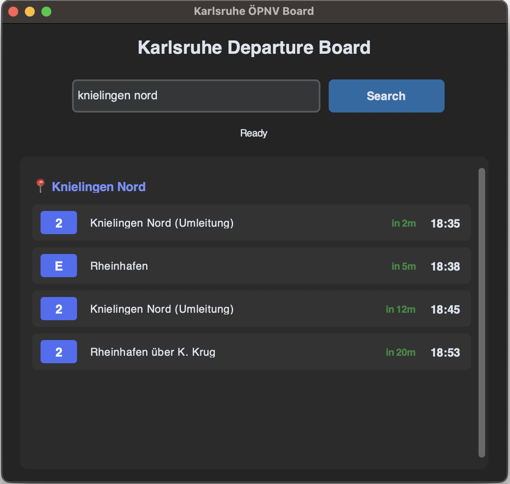

# Karlsruhe Departure Board

Desktop app that shows the next departures for a public transport stop in Karlsruhe, based on GTFS timetable data.

## Features
- Stop search with results grouped by station
- Line, destination, departure time and minutes until departure
- Respects service days (`calendar.txt` / `calendar_dates.txt`)
- Timetable data is loaded once at startup in a background thread, so searches are instant

## Setup
1. Install the dependency: `pip install -r requirements.txt`
2. Download the GTFS feed from https://www.kvv.de/fahrplan/fahrplaene/open-data.html and unzip it into a folder named `data/` next to `app.py`
3. Run the app: `python app.py`

## Known limitations
- Timetable data only, no live delays
- Trips that started on the previous service day and run past midnight are not shown

## Project structure
- `data_load.py`: reads the GTFS files once and answers departure queries from memory
- `app.py`: CustomTkinter user interface

## Data
Timetable data is not included in this repository. See the data provider's licence for terms of use.
